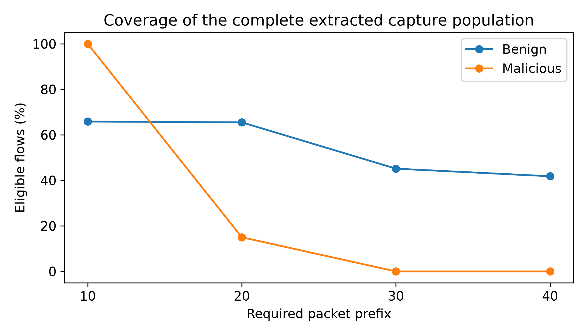
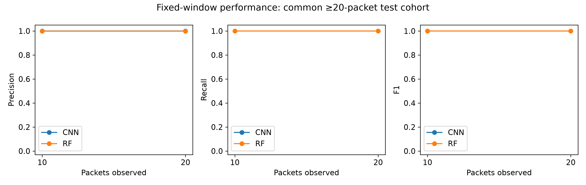
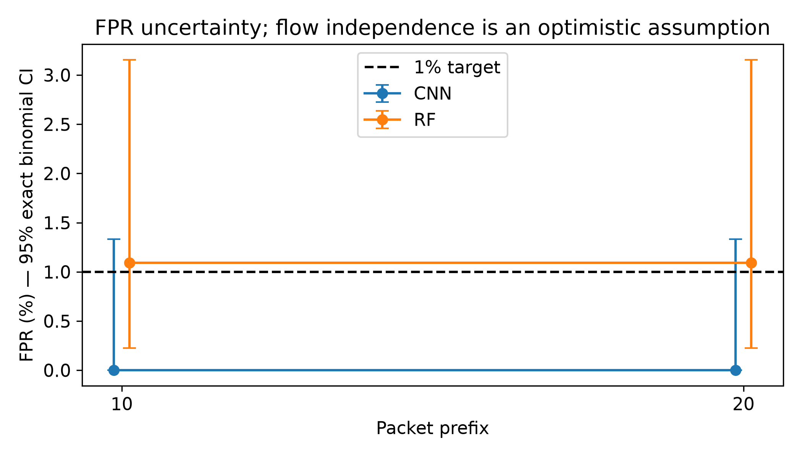
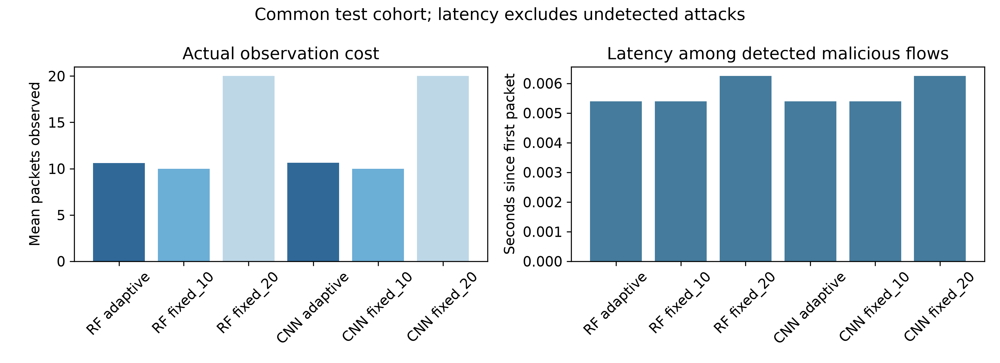
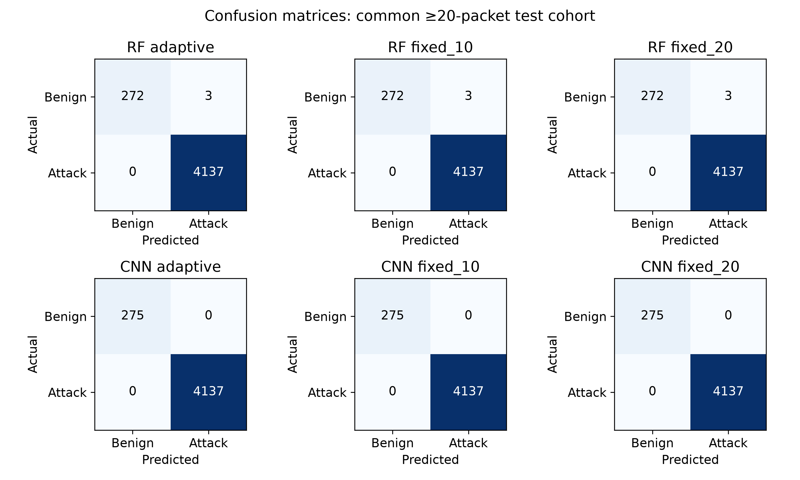
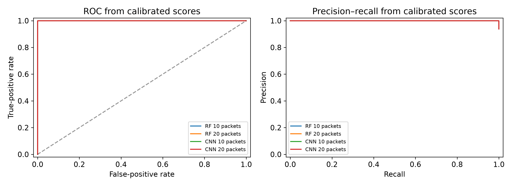
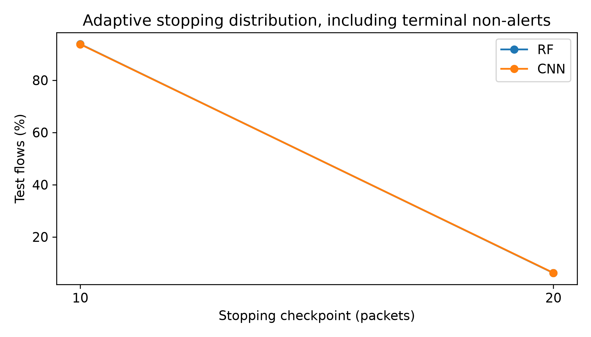

# Report figures

All figures use real-capture preliminary within-capture outputs. Each PNG is 300 dpi; each SVG keeps editable text.

## Checkpoint Coverage

[Editable SVG](checkpoint_coverage.svg)

## Precision Recall F1

[Editable SVG](precision_recall_f1.svg)

## Fpr Confidence Intervals

[Editable SVG](fpr_confidence_intervals.svg)

## Observation Cost And Latency

[Editable SVG](observation_cost_and_latency.svg)

## Confusion Matrices

[Editable SVG](confusion_matrices.svg)

## Roc Precision Recall

[Editable SVG](roc_precision_recall.svg)

## Stopping Distribution

[Editable SVG](stopping_distribution.svg)